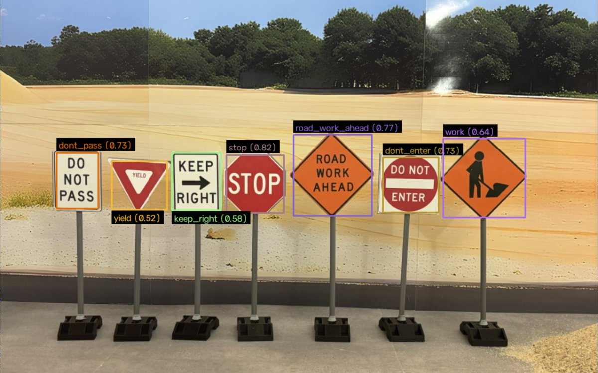
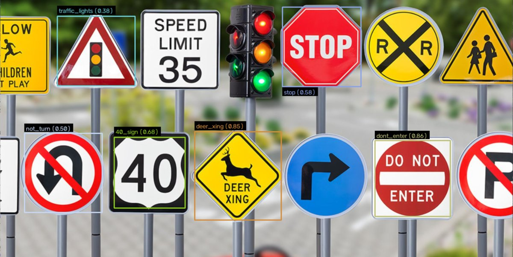

# GTI411 - Lab 2 : Filtrage

Détection de panneaux de signalisation avec du traitement d'image classique (OpenCV), sans deep learning.

Laboratoire réalisé dans le cadre du cours GTI411 – Imagerie numérique (ÉTS Montréal, automne 2026). Le rapport complet est dans [`JONNIAUX_Mathieu_Rapport_Lab2.pdf`](JONNIAUX_Mathieu_Rapport_Lab2.pdf).

- **Partie 1** : on dessine un rectangle à la souris autour d'un panneau, le programme dit quel template ressemble le plus (ou « Inconnu »).
- **Partie 2** : le programme trouve les panneaux tout seul (masques HSV, morphologie, contours) puis réutilise la comparaison de la partie 1.

## Résultats

Sur les deux images de test fournies :

- **Image 1** : les 7 panneaux sont détectés et identifiés, sans fausse détection.
- **Image 2** : les 6 panneaux qui ont un template sont détectés, sans fausse étiquette ; la voiture rouge floue est rejetée par le filtre de netteté (variance du Laplacien).





**Limites** : les seuils ont été réglés sur ces deux images seulement ; la corrélation ne gère pas les fortes rotations ni les déformations de perspective (détails et pistes d'amélioration dans le rapport).

## Organisation (MVC)

- `models/`
  - `chargeur_images.py` : chargement des templates et des images de test
  - `similarite.py` : comparaison zone / template (Sobel, couleurs HSV, matchTemplate à plusieurs échelles)
  - `detection_zones.py` : masques de couleur, morphologie, boîtes englobantes, fusion, netteté (Laplacien)
- `views/`
  - `interface.py` : fenêtre Tkinter pour choisir l'image et la partie
  - `fenetre.py` : fenêtre OpenCV redimensionnable (souris, plein écran)
  - `affichage.py` : dessin des cadres et des étiquettes
- `controllers/`
  - `partie1.py` : sélection manuelle
  - `partie2.py` : détection automatique

## Installation

```bash
python -m venv .venv
.venv\Scripts\activate        # Windows
pip install -r requirements.txt
```

## Lancer

```bash
python main.py
```

Dans la fenêtre de l'image : Echap pour quitter, F pour le plein écran, C pour effacer les cadres.
